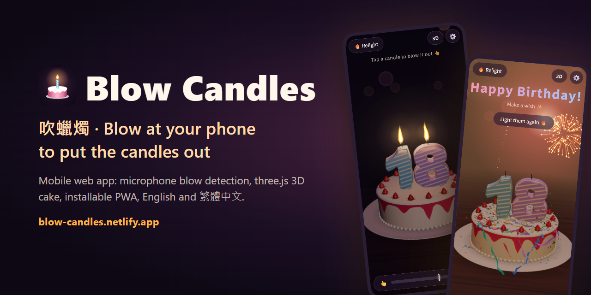

# 吹蠟燭 Blow Candles

[English](README.md) | **繁體中文**

免費的線上虛擬生日蛋糕，在手機瀏覽器上就能玩：對著手機麥克風吹氣，就能把生日蠟燭吹熄。不用下載 App，也可以安裝到主畫面當 App 用。

**線上試玩：** https://blow-candles.netlify.app/ （繁體中文）· https://blow-candles.netlify.app/en/ （English）

[](https://blow-candles.netlify.app/)

app 本身是單一個 [`index.html`](index.html)。旁邊的檔案：

- [`en/index.html`](en/index.html) 是英文頁，由 [`tools/build-en.mjs`](tools/build-en.mjs) 從 `index.html` 產生。
- [`manifest.webmanifest`](manifest.webmanifest)、[`manifest.en.webmanifest`](manifest.en.webmanifest)、[`sw.js`](sw.js)、`icons/` 和 `screenshots/` 讓它可以安裝成 app。
- [`robots.txt`](robots.txt)、[`sitemap.xml`](sitemap.xml) 和 `social/` 給搜尋引擎和連結預覽使用。
- [`google7b8777b763256a2e.html`](google7b8777b763256a2e.html) 是 Google Search Console 的網站驗證檔，請不要刪除。

## 功能

- **蠟燭**：預設是數字蠟燭（最多 4 位數，例如 `18`、`2026`），也可以改成單支蠟燭（1–40 支）。
- **蛋糕**：設定裡可以選經典、巧克力、草莓鮮奶油，或選「不要」只顯示蠟燭。
- **3D 即時光影（預設）**：右上角按鈕可切換，開始畫面也能先選 2D。
  - 用 three.js 繪製，有立體蛋糕與數字蠟燭。
  - 光源在火焰位置並跟著閃爍，蠟燭會投下陰影，蠟會透出暖光，吹熄後冒煙。
  - 針對手機最佳化：只在火焰處放一盞光源，搭配柔和補光，不用陰影貼圖或後製特效。
  - 在電腦、橫放的平板這類寬螢幕上，鏡頭會自動拉遠，整個蛋糕和所有火焰都看得到。
  - 不支援時自動改用 2D。
- **2D 版本**：在各種裝置上都能流暢運作。
- **特效強度**：設定裡可以選低、中、高（預設）、極高。
  - 越低，煙火和彩花越少、解析度越低，適合較慢的裝置和平板這類大螢幕。「低」沒有煙火，彩花也幾乎沒有。
  - 「極高」會放出多很多的煙火、彩花和彩帶，解析度也更高，適合效能很好的裝置。
  - 畫面變慢時會自動降低解析度（3D 畫面和後面的煙火都會降），並提示可以把特效調低。選了特效強度後，馬上恢復該強度的完整解析度，不用重新整理。
  - 在鎖定 30 fps 的螢幕上（例如開了低耗電模式的 iPhone、iPad），降低解析度沒有幫助，所以會恢復完整解析度，只顯示提示。
- **慶祝畫面**：全部吹熄後：
  - 播放生日快樂歌，放煙火。
  - 兩側拉炮噴出彩花和彩帶。
  - 過一會兒，室內燈光漸漸轉成暖色，像有人開了燈；重新點燃後恢復燭光氛圍。
- **吹氣偵測**：
  - 向瀏覽器要求原始的麥克風訊號，關閉回音消除、降噪、自動增益和人聲隔離。手機為了通話會開這些處理，可能在網頁收到聲音前就把吹氣聲消掉。設定裡會顯示瀏覽器實際關掉了哪些。
  - 以「比環境噪音大多少」來判斷，所以安靜房間和吵雜餐廳的感覺一致。
  - 說話聲、敲到手機這類短暫聲音會被過濾掉。
  - 吹氣是累積計算的，忽大忽小的吹氣也能吹熄。
- **吹熄門檻**：預設 50，可以在設定裡拖曳門檻線，調整吹熄的難易度。
- **吹熄進度條**：在吹氣強度條上方，火焰越弱進度越多，並顯示已經吹熄幾支。沒吹熄就停下來的話，進度會退回去。預設開啟，可以在設定裡關掉；點蠟燭模式不顯示。
- **自動校準（需要時再用）**：吹不熄的話，先安靜 2 秒、再吹 3 秒，就會自動設定門檻。
- **音效**：吹熄的氣音與煙霧聲、點火聲；全部在瀏覽器即時合成，不用音檔。
- **可以安裝成 app**：安裝後從主畫面開啟是全螢幕，沒有網路也能開。
  - Chrome、Edge、Samsung Internet 會自己提示安裝：網址列出現安裝圖示，Android 會跳出橫幅。開始畫面和設定裡也會出現「安裝到主畫面」按鈕。
  - iPhone、iPad 沒有安裝提示，開始畫面和設定裡會說明做法：點「分享」，再選「加入主畫面」。
- **中英文介面**：兩種語言各有自己的網頁。
  - https://blow-candles.netlify.app/ 是繁體中文，https://blow-candles.netlify.app/en/ 是英文。
  - 開始畫面有連到另一種語言的連結。在那裡或設定裡選的語言會被記住，兩個網頁都會使用。
- **網址參數**：
  - `?num=25`：數字蠟燭，顯示 25
  - `?count=3`：3 支單支蠟燭
  - `?cake=classic`、`?cake=chocolate`、`?cake=strawberry`：指定蛋糕口味
  - `?cake=0`：只顯示蠟燭，不顯示蛋糕
  - `?r=2d`／`?r=3d`：直接使用 2D 或 3D 畫面
  - `?th=50`：指定吹熄門檻（5–95）
  - `?fx=low`、`?fx=medium`、`?fx=high`、`?fx=ultra`：指定特效強度
  - `?lang=en`／`?lang=zh`：這次開啟時使用指定的語言（不會記住）
  - `?q=0`～`?q=2`：固定 3D 畫質，不自動調整
  - `?debug`：顯示偵測數值、特效強度、每格時間和目前解析度

## 使用與部署

手機瀏覽器只在 **HTTPS**（或 `localhost`）下允許使用麥克風，所以請放在 HTTPS 網址上，例如 Netlify、GitHub Pages。直接開啟本機檔案，或嵌入在 claude.ai 等網站的 iframe 裡，都無法使用麥克風。這種情況下可以用「點蠟燭吹熄」模式。

本機測試：

```bash
python -m http.server 8765
```

然後開啟 http://localhost:8765/ 。

英文頁在 http://localhost:8765/en/ 。

每次修改 `index.html` 後，都要重新產生英文頁（需要 Node.js 18 以上）：

```bash
node tools/build-en.mjs
```

`node tools/build-en.mjs --check` 會在 `en/index.html` 沒有更新時回報錯誤。

部署時請上傳整個資料夾，包括 `en/`、兩個 manifest、`sw.js`、`icons/`、`screenshots/`、`social/`、`robots.txt`、`sitemap.xml` 和 Google 驗證檔。更動 app 檔案清單後，記得把 `sw.js` 裡的 `VERSION` 加一。

3D 版本會從 jsDelivr 載入 three.js 0.160，需要網路連線與支援 import maps 的瀏覽器（iOS Safari 16.4 以上）。

有些處理是網頁控制不到的。iPhone 控制中心的「麥克風模式」如果設成「人聲隔離」，請改回「標準」；部分手機的麥克風硬體本身也會濾掉風噪。

## 搜尋引擎與連結預覽

- 每個網頁都有自己語言的標題、描述、標準網址和結構化資料（JSON-LD）。
- `hreflang` 連結告訴搜尋引擎這兩頁是同一個 app 的兩種語言；其他語言的使用者預設看到英文頁。
- 在 LINE、Facebook、Threads、X、Discord 分享連結時，會顯示 `social/og-zh.jpg` 或 `social/og-en.jpg`。
- `robots.txt` 指向列出兩個網頁的 `sitemap.xml`。

網站已登記到搜尋引擎：

- [Google Search Console](https://search.google.com/search-console)：網址前置字元資源 `https://blow-candles.netlify.app/`，用 `google7b8777b763256a2e.html` 驗證，並已提交 `sitemap.xml`。
- [Bing Webmaster Tools](https://www.bing.com/webmasters)：從 Google Search Console 匯入，所以不需要另外的驗證檔。Bing 也會從 `robots.txt` 找到 sitemap；如果它的 Sitemaps 頁面還是空的，請在那裡提交 `https://blow-candles.netlify.app/sitemap.xml`。

如果網站換了網址，要更新 `index.html` 的 `seo:start` 區塊、`tools/build-en.mjs` 的 `SITE`、`robots.txt` 和 `sitemap.xml` 裡的網址，再重新產生英文頁。

## 版本紀錄

| 版本 | 日期 | 內容 |
|---|---|---|
| v1.0.0 | 2026-10-07 | 2D 畫面、單支與數字蠟燭、麥克風吹氣、靈敏度門檻、合成音效與生日歌 |
| v2.0.0 | 2026-10-07 | 吹熄音效改成柔和的氣音；重寫吹氣偵測（環境噪音基準、說話過濾、累積計算）；自動校準 |
| v3.0.0 | 2026-10-08 | 即時 3D 繪圖（three.js），預設 3D，可切換 2D |
| v4.0.0 | 2026-10-08 | 3D 針對手機最佳化；煙火、彩花與彩帶；慶祝時室內燈光轉暖；英文介面；經典、巧克力、草莓鮮奶油蛋糕或不顯示蛋糕；關閉手機通話用的麥克風處理，取得原始訊號；預設門檻 75 與數字蠟燭；自動校準改為需要時再用 |
| v4.1.0 | 2026-10-09 | 可安裝成 app，沒有網路也能開；英文頁 /en/；搜尋與分享用的資訊、sitemap；每個網頁顯示自己的語言 |
| v4.2.0 | 2026-10-09 | 預設門檻 60；安裝畫面的預覽圖改成中文、英文各一張 |
| v5.0.0 | 2026-10-12 | 特效強度（低、中、高、極高），解析度降低時提示調整，切換強度即恢復解析度、不用重新整理；吹熄進度條；3D 鏡頭適配寬螢幕；預設門檻 50；搜尋與分享文字改稱虛擬生日蛋糕 |

詳細的每一步調整請看 commit 紀錄。

## 測試

[`tests/`](tests/) 內是開發時使用的無頭瀏覽器測試。它會用合成的錄音（吹氣、說話、敲擊、咖啡廳噪音）餵給模擬麥克風，確認吹氣會熄滅、其他聲音不會誤觸。另外也測試自動校準和 3D 繪圖。執行方式請看 [`tests/README.md`](tests/README.md)。

## 授權

[MIT](LICENSE)
